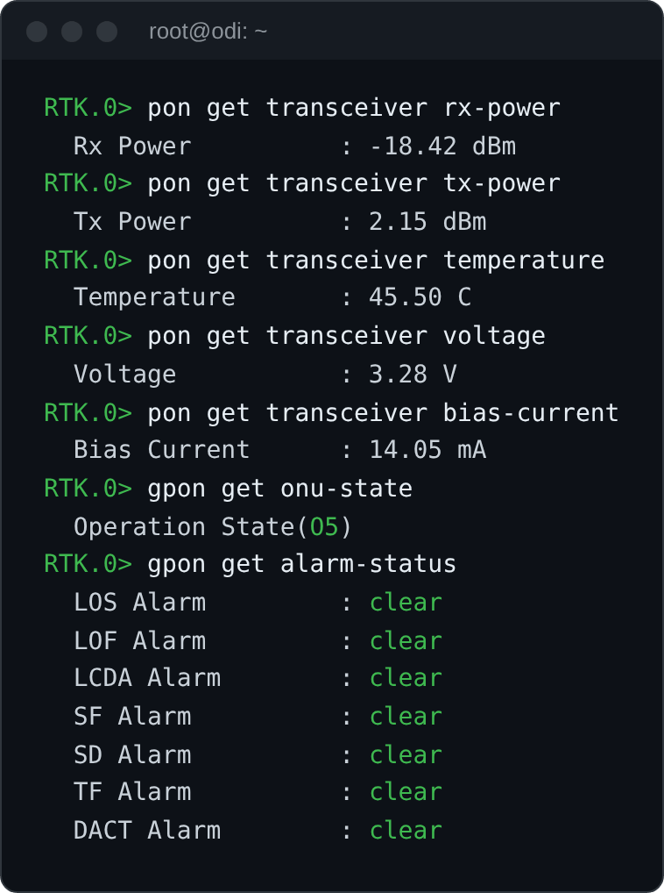

# odi-oss

Open firmware for the **ODI DFP-34X** family of GPON SFP ONU sticks and
close rebrands on the same SoC
(Realtek RTL9602C SoC, Lexra RLX5281 CPU, 32 MB RAM, 8 MB NOR flash),
built from source: a current mainline Linux kernel, our own drivers and
userland, and our own toolchain. It replaces the closed stock image, which
runs Linux 2.6.30; it is not a repack of it.

| | boards | what stands behind it |
|---|---|---|
| **Lab-tested** | ODI DFP-34X-2C2, hardware v06 | written for this board; two sticks on two ISPs' GPON lines run it as their committed image |
| **Running on user reports** | ODI DFP-34X-2C3, Luleey LL-XS2510, and the DFP-34X-2C2 hardware v08 sold as the HSGQ XPON stick | issues linked under [Supported hardware](#supported-hardware); not reproduced in the lab |
| **Untested** | every other stick, also with the same SoC | the image drives the board directly; do not flash it without reading that section |

> [!WARNING]
> **This repository was written with AI assistance ("vibecoded") and
> validated on real hardware, with no warranty of any kind.** Flashing a
> stick with the wrong image, or interrupting a flash, can brick the stick
> or take down the fiber (GPON) service it is carrying. Read
> [Safety model](#safety-model) and
> [Install from the stock firmware](#install-from-the-stock-firmware)
> before you flash anything, and never flash a stick that is your only
> connection to the Internet without a way back.

## Contents

- [Highlights](#highlights)
- [Supported hardware](#supported-hardware)
- [Safety model](#safety-model)
- [Install from the stock firmware](#install-from-the-stock-firmware)
- [Logging in, and getting back in](#logging-in-and-getting-back-in)
- [Going back, and updating](#going-back-and-updating)
- [Screenshots](#screenshots)
- [Compared with the stock firmware](#compared-with-the-stock-firmware)
- [Status and limitations](#status-and-limitations)
- [Building from source](#building-from-source)
- [Documentation](#documentation)
- [Contributing and security](#contributing-and-security)
- [License](#license)
- [Related repositories](#related-repositories)

## Highlights

- **Open and buildable.** Mainline Linux 6.18 (LTS), our own GPL switch
  and GPON MAC driver, our own OMCI daemon (`omcid`) and tools; no
  proprietary code shipped or linked. With the prebuilt toolchain images,
  `git clone` to a flashable tarball takes about six minutes on a native
  8-core x86_64 host.
- **Hard to lock yourself out of.** A new image boots once, on trial, from
  the slot you are not running, and goes back by itself if it hangs or its
  management path is not seen working within 300 s. A change of the
  management address or of the host port mode is a trial too. A safe mode
  from the power alone gets you back into a stick whose password, keys or
  host port mode are lost.
- **Built for a line that has to stay up.** An OLT software download is
  answered and discarded, never flashed. A reboot request from the OLT is
  refused by default. By default nothing from the fibre but OMCI gets past
  the switch and the NIC driver. No telnet; release images are ssh
  keys-only.
- **Something to look at when it goes wrong.** A system log with one
  greppable `event=` line per link or provisioning event, a Prometheus
  exporter, GPON line counters sampled every second, records of the time
  around a drop out of O5, and a one-click diagnostics bundle.
- **Tested before it reaches a stick.** Host tests against register
  models, the OMCI daemon replayed under qemu against captures from two
  ISPs, CI on every pull request.

Each point is a line of
[Compared with the stock firmware](#compared-with-the-stock-firmware),
with its evidence in [`docs/COMPARISON.md`](docs/COMPARISON.md).

## Supported hardware

The image drives the board directly (GPIO numbers, I2C wiring of the
optics, flash layout, switch and PON registers), so on a stick with another
board it will at best not boot and at worst leave it unreachable.

| board | state | what it needs | evidence |
|---|---|---|---|
| ODI DFP-34X-2C2, hardware v06 (SC/UPC, blue) | Maintainer-tested | nothing: the defaults are this board's | the reference board; two lab sticks, ISP1 and ISP2 |
| ODI DFP-34X-2C2, hardware v08, sold as the HSGQ XPON stick | Community-reported | `HOST_SERDES=2500basex` before the first boot for a 2.5 Gb/s host port; whether this board links in Fiber 1G is untested | [#229](https://github.com/AndreZiviani/odi-oss/issues/229), [#231](https://github.com/AndreZiviani/odi-oss/issues/231) (v1.15.0 at 2.5G), [#300](https://github.com/AndreZiviani/odi-oss/issues/300) (v1.15.0: PPPoE, IPTV and voice), [#369](https://github.com/AndreZiviani/odi-oss/issues/369) (v1.16.0, a second reporter) |
| ODI DFP-34X-2C3 (SC/APC, green) | Community-reported | nothing in an auto-negotiating 1G port. Reports ran `HOST_AUTONEG=off` on a port forced to 1G and `HOST_SERDES=hisgmii` through a 2.5G media converter. The image still calls the stick a 2C2 | [#241](https://github.com/AndreZiviani/odi-oss/issues/241) (v1.14.0, installed from stock, committed), [#42](https://github.com/AndreZiviani/odi-oss/issues/42), [#299](https://github.com/AndreZiviani/odi-oss/issues/299), [#478](https://github.com/AndreZiviani/odi-oss/issues/478) (v1.18.1) |
| Luleey LL-XS2510 | Community-reported | `HOST_SERDES=2500basex` before the first boot: its host side runs at 2.5 Gb/s. Fiber 1G is untested on it | [#302](https://github.com/AndreZiviani/odi-oss/issues/302), [#319](https://github.com/AndreZiviani/odi-oss/issues/319), [#321](https://github.com/AndreZiviani/odi-oss/issues/321) (v1.15.0 and v1.16.0-beta.1 on trial; tagged PPPoE from v1.16.0-beta.1 on) |
| anything else (other ODI models, other RTL9601/RTL9602C sticks, rebrands with a different board) | Untested | | no run of any kind |

The states are those of [`docs/QUALIFICATION.md`](docs/QUALIFICATION.md):
**Maintainer-tested** means the maintainer ran it on a stick;
**Community-reported** means a user ran it on their own stick and wrote it
up in the linked issue, and it was not reproduced here. That page keeps the
word "supported" for a path that has passed its whole qualification suite
on one release, and has the full matrix: boards, laser drivers, hosts,
SerDes modes and OLT lines.

Two things decide whether a stick comes up at all:

- **The laser driver.** The laser is off until the image has identified
  the laser driver chip as the one it is tested with (the Semtech GN25L95,
  id 0x6a). On another chip the ONU stays dark and never registers. An
  override exists (`ODI_LASER_UNVERIFIED`), but a laser lit outside its
  timeslots takes down every other ONU on the OLT port, so it is for an
  OLT port with no other ONU ([`docs/SETTINGS.md`](docs/SETTINGS.md)).
- **The host port mode.** The default is Fiber 1G (1000BASE-X) with
  auto-negotiation, as on the stock DFP-34X-2C2. Both the speed and the
  negotiation must match the host: `HOST_SERDES` for a 2.5 Gb/s port,
  `HOST_AUTONEG=off` for a port forced to 1G
  ([`docs/SETTINGS.md`](docs/SETTINGS.md), "Host port SerDes mode").

A report from your stick, working or not, helps:
[`docs/QUALIFICATION.md`](docs/QUALIFICATION.md), "Adding a report".

## Safety model

This firmware is meant to be flashed **into the slot the stick is not
currently running from**, and booted **once, on trial**, before it is ever
made permanent:

- The stick has **two boot slots** (kernel + rootfs pairs). You always
  flash the slot you are *not* running, so the working image, normally the
  stock (OEM) firmware, stays untouched in the other slot the whole time.
- A newly flashed slot is **inert** until you tell the bootloader to try
  it: `nv setenv sw_tryactive <slot>` boots that slot **exactly once**,
  with the hardware watchdog armed. If the new image does not come up
  (kernel panic, no root filesystem, a boot that does not confirm within
  120 s), the watchdog resets the board and the bootloader falls back to
  the slot it already trusts.
- **The trial guard** covers a trial that boots but cannot be reached: it
  resets the board 300 s after it arms unless the management path is seen
  working both ways (a TCP session from the host, such as a login or a
  metrics scrape, or a neighbour that answered the stick). It does not see
  a path that fails later, or an image that is reachable and misbehaves.
- **Commit a trial yourself, once you have watched it work.** A commit
  (`nv commit <slot>`, run on the trial) removes the automatic fallback: a
  committed image that later crashes reboots into itself. The other slot
  can then only be chosen from a shell that still works. Until you commit,
  the image says it is a trial: at every ssh login, and as
  `gpon_uncommitted` on the exporter.

Only the slot rolls back. The config partition is shared by both slots, so
a setting saved during a trial is still there when the stick is back on
the other image. The full procedure and the recovery are in
[`docs/FLASHING.md`](docs/FLASHING.md).

## Install from the stock firmware

The short path from a stick on its stock (OEM) firmware to a committed
odi-oss image. Each step names the section with the detail; read
[`docs/FLASHING.md`](docs/FLASHING.md) once before you start. Below,
`IMG` is the image tarball (`<version>.tar`), `NEW` the slot you flash and
`OLD` the slot you are running.

**Before you flash, know:**

- [ ] the board and its revision, and that it is in the table above;
- [ ] the host port's speed and whether it negotiates or is forced;
- [ ] the stick's management address, and that you can reach its shell;
- [ ] that you have a backup of the flash, checked for size and digest;
- [ ] which slot is running, that `sw_commit` names it, and that no trial
      is pending (`sw_tryactive=2`).

1. **Back up the flash**, and keep the copy private: the `config`
   partition holds the identity the OLT authenticates the line on, in
   clear text, and no image can rebuild it. With telnet only, the shell is
   one connection and `nc` a second one: the stick listens, the host
   connects, and a pull needs `-d` on the host or it is silently cut short
   ([`docs/FLASHING.md`](docs/FLASHING.md), "Backing up the whole flash").

       nc -l -p 12346 < /dev/mtd3ro                 # stock shell, per partition
       nc -d -w 5 <stick> 12346 > config.bin        # host; then compare size and md5sum

2. **Get an image and verify it**, on the host. Download `IMG` and
   `SHA256SUMS` from
   [Releases](https://github.com/AndreZiviani/odi-oss/releases), or build
   your own ([Building from source](#building-from-source)).

       sha256sum -c --ignore-missing SHA256SUMS     # the file also lists the sources and the SBOM
       gh attestation verify IMG -R AndreZiviani/odi-oss    # needs a signed-in gh

   ([`docs/FLASHING.md`](docs/FLASHING.md), "Verifying a release").

3. **Set the host port mode, if the default does not fit your host.** A
   2.5 Gb/s host port needs the key before the first boot, from the stock
   shell. The first `HOST_SERDES=` line in the file wins, so check for one
   and replace it instead of adding a second:

       grep HOST_SERDES /var/config/odi.conf        # stock shell; expect nothing
       echo HOST_SERDES=2500basex >> /var/config/odi.conf

   A v06 or a 2C3 in an auto-negotiating 1G port skips this
   ([`docs/SETTINGS.md`](docs/SETTINGS.md), "Host port SerDes mode").

4. **Flash the slot you are not running.** In the stock shell:

       cat /proc/cmdline; cat /proc/mtd    # root=31:N, N is the mtd number of r0 (slot 0) or r1 (slot 1)
       nv getenv                           # sw_commit must equal OLD, sw_tryactive must be 2

   On the reference layout `root=31:5` is slot 0 and `root=31:7` slot 1.
   The stock `nv` shows one of the two environment copies only, so
   `fwu.sh` may warn that it could not check the other. Push the tarball
   into `/tmp`, stop the listener on the stick by hand once the host side
   has returned, and compare `md5sum` on both ends
   ([field note](docs/kb/rtl9601-netcat-file-transfer.md)):

       nc -l -p 12345 > /tmp/IMG           # stock shell
       nc -w 5 <stick> 12345 < IMG         # host

   Then unpack only the flasher and run it:

       cd /tmp && tar xf IMG fwu.sh md5.txt     # stock shell
       ./fwu.sh NEW IMG

   `fwu.sh` refuses the running slot and the slot `sw_commit` names,
   verifies both members before it erases anything, and never touches the
   config partition ([`docs/FLASHING.md`](docs/FLASHING.md), "Before
   anything" and "Flashing"). One user installed from the stock web page
   instead ([#299](https://github.com/AndreZiviani/odi-oss/issues/299)).

5. **Boot it once, on trial**, from the stock shell:

       nv setenv sw_tryactive NEW
       reboot

   Open the web UI or log in within five minutes, or the trial guard takes
   the stick back to the stock slot
   ([`docs/FLASHING.md`](docs/FLASHING.md), "Trial-booting it").

6. **Log in**: [Logging in, and getting back in](#logging-in-and-getting-back-in).

7. **Check it, then commit**, in the trial's shell: the laser on
   (`dmesg | grep 'odi_board: laser'`), the ONU in O5 (`omcli state`),
   traffic flowing.

       nv commit NEW
       slot-state.sh

   ([`docs/FLASHING.md`](docs/FLASHING.md), "Committing").

If the trial does not come up, or comes up and you cannot reach it:
[`docs/FLASHING.md`](docs/FLASHING.md), "If it does not come up".

## Logging in, and getting back in

**Where.** The config partition is shared with the stock firmware, so the
stick answers on the management address stored there; 192.168.1.1/24 is
the stock default and what an image with no valid stored address uses
([`docs/SETTINGS.md`](docs/SETTINGS.md)). The web UI is on port 80, ssh on
22, the exporter on 9100.

**First login**, once the trial image is up:

- **Release image, or a source build with `ROOT_PW=locked`**: root has no
  password at all (ssh with a password is refused). Open the web UI on
  port 80 (`admin`/`admin` at first), set a password of your own under
  System, Access, then add your SSH public key on the same page: confd adds
  no key while `admin`/`admin` is in force. `ssh root@<stick>` with that
  key then works, and keeps working across reboots and re-flashes (the key
  lives on the config partition, not in the image).
- **A default source build**: ssh as `root` with the password
  `image/build.sh` generated for that build
  (`out/image/root-password-<version>.txt`), or the web UI the same way as
  above, its password first. Add your own SSH key from there; the root
  password stays valid beside it.

Either way, the web UI's own default credential is what a freshly reset or
freshly flashed stick answers to, so change it before anything else. Full detail, including
every port and how to move files on and off the stick:
[`docs/ACCESS.md`](docs/ACCESS.md).

A web UI credential and SSH keys already stored on the config partition
survive a flash: `admin`/`admin` applies only while none is stored.

**Locked out of a committed image** (a forgotten web UI password, lost ssh
keys, a host port mode the router does not speak)? The safe mode needs
nothing but the power:

1. Plug the stick in, wait about 80 seconds, pull it. Do that five times in
   a row (three with `HOST_AUTONEG=off` or `HOST_SERDES` other than
   `fiber1g`), then plug it in and leave it in.
2. That boot runs the host port in Fiber 1G with auto-negotiation, so the
   host must speak 1G, keeps the PON off, and adds the rescue address
   169.254.1.1/16 beside the stored one.
3. The web UI and root accept the password `admin` for that boot only. Set
   a new password, acknowledge, reboot.

The passwords are temporary; the host port keys are not: a safe mode
reached by power cycles removes `HOST_AUTONEG`, `HOST_SERDES` and
`OMCI_UNI_LOCK=1` from the saved configuration. Physical access to the
power is enough for all of this, which is the documented trade-off. On
hardware, the three-cycle path ran with real power cycles and the
five-cycle path by setting the counter
([`docs/SETTINGS.md`](docs/SETTINGS.md), "Recovery: the safe mode").

## Going back, and updating

Which way back you have depends on where you are:

| where you are | the way back | what it does not undo |
|---|---|---|
| on an uncommitted trial | any reboot or power cycle boots the stock slot again | settings saved on the shared config partition. The stock firmware's own management has been seen to write `sw_commit` by itself: read it back (`nv getenv sw_commit`) |
| committed, stock still in the other slot | from a working shell, `nv setenv sw_tryactive OLD` and a reboot boot the stock slot once. Making stock permanent again has no tested recipe here: read `sw_commit` back under stock, which has been seen to write it itself ([`docs/FLASHING.md`](docs/FLASHING.md)) | the same settings. Nothing sends a committed image back by itself |
| after the first update | the update normally went into the slot that held the stock firmware, so the way back is the odi-oss release you left | the stock image is then gone from the stick; your flash backup is the only copy |

**Updating** is the same procedure with this firmware in the place of the
stock one: flash the slot you are not running, trial it, commit it by hand.
From a running odi-oss image the tarball goes over with
`scp -O IMG root@<stick>:/tmp/`. The web UI's Firmware page writes the
inactive slot with the same `fwu.sh`; its guards are host-tested, and a
write from the page on a stick is not yet recorded in
[`docs/QUALIFICATION.md`](docs/QUALIFICATION.md), so `fwu.sh` by hand is
the proven path. Only the latest release is supported
([`SECURITY.md`](SECURITY.md)). Read the [`CHANGELOG.md`](CHANGELOG.md)
sections between your release and the new one first: some releases change
what you see on the line (v1.4.0 the laser check and the OLT's VLAN, v1.5.0
`/proc/odi_gpon`, v1.6.0 the MIB upload).

## Screenshots

| Web UI ([odi-ui](https://github.com/AndreZiviani/odi-ui)) | `diag` on the stick |
|---|---|
|  |  |

Identifiers in the screenshots are placeholders. More pages in the
[odi-ui README](https://github.com/AndreZiviani/odi-ui#screenshots).

## Compared with the stock firmware

One line per area. [`docs/COMPARISON.md`](docs/COMPARISON.md) is the full
table, row by row, with the conditions of each number and what it was
measured or tested on, and [`docs/IMPROVEMENTS.md`](docs/IMPROVEMENTS.md)
tells it as prose. "Stock" is the OEM image as observed on the lab sticks.

| area | stock (OEM) firmware | this firmware | detail |
|---|---|---|---|
| source and kernel | closed; Linux 2.6.30 | fully open, built from source; Linux 6.18 (LTS), carried as 19 changed lines in 6 mainline files plus our own overlay | [`KERNEL.md`](docs/KERNEL.md) |
| switch, GPON MAC and OMCI | closed | our own GPL driver built into the kernel, our own `omcid` with `omcli`, `omciprobe` and `omcicap` | [`SWITCH.md`](docs/SWITCH.md), [`TOOLS.md`](docs/TOOLS.md) |
| fibre loss | leaves O5 and ranges again | the same, by G.984.3; the line is sampled every 100 ms; on a stick, three fibre pulls of 16 to 27 s each came back to O5 with no reboot | [`SWITCH.md`](docs/SWITCH.md) |
| host port | negotiates PAUSE (an Intel 10G NIC behind one stick received about 5.9 million XOFF frames and reset itself in a loop); no setting for auto-negotiation; no trial | sends no PAUSE by default; `HOST_AUTONEG` and `HOST_SERDES` (Fiber 1G, 2500BASE-X, HiSGMII), each change a trial that reverts after 120 s unless confirmed | [`SETTINGS.md`](docs/SETTINGS.md) |
| VLAN and multicast | manual tag, or the VLAN the OLT asks for; closed IGMP handling | stick tags, router tags, or the OLT's own table; up to 12 VLAN filter entries; IGMP and MLD snooping as opt-ins, not yet run against a real multicast stream | [`SETTINGS.md`](docs/SETTINGS.md), [`SWITCH.md`](docs/SWITCH.md) |
| what the OLT can do to the stick | a software download flashes the ISP image and reboots into it | the download is answered and discarded, nothing is flashed; a reboot request is refused unless `OMCI_ACCEPT_REBOOT` allows it | [`SETTINGS.md`](docs/SETTINGS.md) |
| login | telnet on by default with `admin`/`admin`; an old dropbear | no telnet; a current dropbear with `scp`; release images keys-only | [`ACCESS.md`](docs/ACCESS.md) |
| management from the fibre | port isolation all open | by default two independent layers keep PON frames other than OMCI from the IP stack; watched passively on ISP1 for 30 minutes of real PON traffic, only OMCI frames reached the CPU | [`SWITCH.md`](docs/SWITCH.md) |
| hardening | Linux 2.6.30, older than most of the options | kernel hardening options (9,410 bytes of uImage), stack protector in every daemon of ours (text +6.5% for omcid). The CPU has no execute-inhibit bit and program text sits at a fixed address; stack, heap and mmap base are randomised | [`KERNEL.md`](docs/KERNEL.md), [`CROSS-COMPILING.md`](docs/CROSS-COMPILING.md) |
| trial boot and commit | undocumented; a trial nobody can reach stays up until power-cycled; no sign that a boot is a trial | one-shot trial under a watchdog the kernel owns; a trial whose management path is never seen working reverts after 300 s; `nv commit` writes both environment copies and reads each back; an uncommitted image says so at every login | [`FLASHING.md`](docs/FLASHING.md) |
| recovery | a typo in the management address locks you out; no documented way back from a forgotten password | an address change is a trial that reverts after 90 s; a safe mode from the power alone; the provisioning identity kept on the stick and restorable | [`SETTINGS.md`](docs/SETTINGS.md) |
| memory and daemons | about 1.1 MB free after a cache drop; init restarts a dead daemon with no limit | about 15 MB available; `/tmp` and `/var` capped at 8 MB and 6 MB; a restart budget per daemon; the kernel resets a board whose memory stays below a floor | [`SETTINGS.md`](docs/SETTINGS.md) |
| boot | not a concern of the stock image; no boot debugging | two bootloader leftovers fixed (15 of 15 consecutive trial boots on ISP1, first release); GPON MAC tables cleared and read back at every boot; the previous boot's console kept in DRAM across a watchdog reset | [`BOOT.md`](docs/BOOT.md), [`SWITCH.md`](docs/SWITCH.md) |
| logs, metrics and line quality | no syslog, no metrics; 43 counters that clear on read | `syslogd` with one `event=` line per link or provisioning event; a Prometheus exporter; 64-bit counters sampled every second; the die temperature (scale inferred, not calibrated); up to four drop records of 60 s before and 120 s after | [`TOOLS.md`](docs/TOOLS.md) |
| web UI and diagnostics | closed, minimal; no diagnostics | `confd`: the stock settings this image acts on, each marked with what applying it costs; a link check; firmware upload; a one-click diagnostics bundle with passwords redacted and the identity masked (read it before you post it) | [`SETTINGS.md`](docs/SETTINGS.md), [`TOOLS.md`](docs/TOOLS.md) |
| build and tests | a decade-old vendor cross-compiler; no tests published | our own gcc, binutils and uClibc-ng as images pinned by digest; reproducible images; host tests, omcid under qemu against captures from two ISPs, CI on every pull request and push to `main` | [`BUILDING.md`](docs/BUILDING.md), [`HACKING.md`](docs/HACKING.md) |
| documentation | none | build, flashing and recovery, every setting, the boot stage by stage, the kernel port, a contributor guide | [Documentation](#documentation) |

## Status and limitations

**Tested on real sticks.** The firmware runs on two DFP-34X-2C2 v06 sticks
on two different ISPs' GPON networks, ISP1 and ISP2, and both run it as
their committed image, with the stock firmware kept in the other slot. Each
was first run as a one-shot trial over the stock firmware, as the safety
model describes, and committed only after that. What is maintainer-tested,
community-reported, host-tested or untested, on which release, and what
the maintainer runs before each release, is in
[`docs/QUALIFICATION.md`](docs/QUALIFICATION.md).

This is new, actively developed firmware. Before relying on it:

- **One board family.** It is written for the ODI DFP-34X-2C2 / RTL9602C
  and has run on the sticks under
  [Supported hardware](#supported-hardware). It is not a general MIPS or
  GPON-ONU firmware.
- **No serial console without opening the stick.** The console is a UART
  header on the board. If a trial boot goes wrong and you cannot reach the
  stick, [`docs/FLASHING.md`](docs/FLASHING.md) covers what to do (and
  what it does not); the UART is the last resort, and the point of the
  safety model is to make that resort as rare as possible.
- **The watchdog is armed on every boot.** If the kernel hangs or the boot
  does not confirm within 120 s, the board resets (a trial falls back to
  the committed slot). A committed image that boots but is unreachable is
  not reset: power-cycle it, or use the safe mode.
- **Management is open to the host side.** The web UI, ssh and the exporter
  listen on every address of the stick. By default nothing from the fibre
  reaches the stick's IP stack ([`docs/SWITCH.md`](docs/SWITCH.md), "PON
  port isolation"), but anyone on the host side can reach it: change the
  web UI's `admin`/`admin`.
- **Multicast is unproven on a real stream.** IGMP and MLD snooping are
  opt-in. Neither lab line carries IPTV, so they have been tested against a
  register model, the frame parsers and a host's own reports, not against
  a multicast source, and the OLT's IGMP and MLD proxy modes are not done
  ([`docs/QUALIFICATION.md`](docs/QUALIFICATION.md), "Multicast and voice").
- **`diag` is not the stock CLI.** It carries only the commands our kernel
  can answer (`diag help` lists them). The handful the Prometheus exporter
  uses keep the stock syntax and output, so the exporter reads either
  firmware.
- **The config store is shared with the stock firmware.** This image acts
  on a small part of its keys and the UI shows the rest read-only;
  [`docs/SETTINGS.md`](docs/SETTINGS.md) has each one and what applying it
  costs. Do not delete keys this image does not use: the stock slot still
  reads them.

## Building from source

Everything that compiles for the target builds in Docker containers, and
nothing in the build touches a stick. The host needs Docker, GNU `make`
and a few common tools, and about 20 GB free.

    git clone https://github.com/AndreZiviani/odi-oss.git && cd odi-oss
    make image-all      # kernel, packages, our tools, the image: out/image/<version>.tar
    make test           # lint, host tests, diag and the exporter contract, omcid under qemu

- `make image-all` pulls the toolchain images and fetches the web UI
  (`confd`) and the exporter (`metricsd`) as pinned release assets of
  their own repositories; everything else is compiled here.
- A source build defaults to a random per-build root password, written to
  `out/image/root-password-<version>.txt`. `ROOT_PW=locked` builds the
  keys-only image the releases ship.
- Builds are reproducible: two clean builds of one commit with the same
  inputs (`VERSION`, and `ROOT_PW=locked` or a fixed password) give the
  same tarball, checked by `tools/compare-images.sh`.
- Releases come with `SHA256SUMS`, the corresponding sources, a CycloneDX
  SBOM and GitHub build attestations.

[`docs/BUILDING.md`](docs/BUILDING.md) has every target, the prerequisites,
the timings and their conditions, and the remote-build option.

## Documentation

**Using a stick**

- [`docs/FLASHING.md`](docs/FLASHING.md): verifying a release, backing up
  the flash, the trial-boot procedure, committing, and recovery.
- [`docs/ACCESS.md`](docs/ACCESS.md): ports, the web UI, SSH keys, moving
  files on and off the stick.
- [`docs/SETTINGS.md`](docs/SETTINGS.md): every setting the web UI and the
  config partition offer, which ones this image uses, which need a reboot
  or interrupt the internet connection, and the safe mode.
- [`docs/TOOLS.md`](docs/TOOLS.md): every CLI and daemon: what it does, how
  to run and restart it, what it reads, where it logs, who starts it.
- [`docs/QUALIFICATION.md`](docs/QUALIFICATION.md): what has been checked
  on which board, optics, host, SerDes mode and OLT line, who checked it,
  on which release, and what a path must pass to be called supported.
- [`CHANGELOG.md`](CHANGELOG.md): what each release changed.

**Understanding it**

- [`docs/COMPARISON.md`](docs/COMPARISON.md): the comparison with the stock
  firmware, row by row, with the evidence for each row.
- [`docs/IMPROVEMENTS.md`](docs/IMPROVEMENTS.md): the same ground as prose,
  by theme.
- [`docs/BOOT.md`](docs/BOOT.md): the boot, stage by stage, and why each
  stage sits where it does.
- [`docs/KERNEL.md`](docs/KERNEL.md): the 6.18 kernel port: CPU, board,
  boot, the config, our drivers, the ramlog, how to build and check it.
- [`docs/SWITCH.md`](docs/SWITCH.md): the switch and GPON MAC driver:
  register access, platform and GPON boot init, the host port modes,
  multicast, PON port isolation.
- [`docs/kb/README.md`](docs/kb/README.md): field notes on the device and
  the stock firmware's behaviour, from reverse-engineering real sticks.
- [`docs/REFERENCES.md`](docs/REFERENCES.md): the public specifications the
  GPON code is written against, and how to fetch them.

**Building and changing it**

- [`docs/BUILDING.md`](docs/BUILDING.md): building the whole image, piece
  by piece, locally or on a remote build host.
- [`docs/HACKING.md`](docs/HACKING.md): the contributor guide: layout, the
  build, the recovery mechanism in full, testing, the known traps, and
  every feature toggle.
- [`docs/CROSS-COMPILING.md`](docs/CROSS-COMPILING.md): compiling your own
  C for this CPU, freestanding or against our libc.
- [`docs/LICENSING.md`](docs/LICENSING.md): what license covers what in
  this tree.
- [`CONTRIBUTING.md`](CONTRIBUTING.md): scope, reporting issues, the gates.
- [`AGENTS.md`](AGENTS.md): repo layout, build/test commands and house
  rules, for anyone (human or AI) working on this codebase.
- [`SECURITY.md`](SECURITY.md): supported versions and how to report a
  vulnerability privately.

## Contributing and security

Reports from other sticks, hosts and OLT lines are the most useful
contribution: several OLT behaviours were found only on a user's line.
[`CONTRIBUTING.md`](CONTRIBUTING.md) says what an issue needs (the image
version, what you did, the evidence) and what a pull request must pass
(`make test`, and an entry under `## Unreleased` in `CHANGELOG.md`). Remove
serial numbers, MAC addresses, LOIDs and passwords before you post a log;
the diagnostics bundle masks them by default.

The web UI and the exporter are separate projects
([Related repositories](#related-repositories)); report their issues there.

Report a vulnerability privately, through
[GitHub private vulnerability reporting](https://github.com/AndreZiviani/odi-oss/security/advisories/new),
not in a public issue ([`SECURITY.md`](SECURITY.md)).

## License

Our own code (the drivers and other files in `kernel/extra/`, `src/`, the
rootfs skeleton and the build scripts) is GPL-2.0-or-later; see
[`LICENSE`](LICENSE). The kernel itself stays GPL-2.0-only, as upstream
ships it, and so do our patches to mainline files, which follow the
license of the file they modify. The toolchain and every upstream package
it builds (busybox, dropbear, iproute2) keep their own upstream licenses.
See [`docs/LICENSING.md`](docs/LICENSING.md) for the full breakdown.

## Related repositories

- [odi-ui](https://github.com/AndreZiviani/odi-ui): the web UI, `confd`.
- [odi-sfp-exporter](https://github.com/AndreZiviani/odi-sfp-exporter): the
  Prometheus exporter, `metricsd`.
- [odi-toolchain](https://github.com/AndreZiviani/odi-toolchain): the
  prebuilt build images shared by all three.
